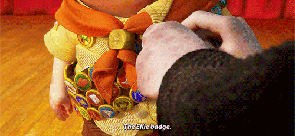

    

    

Like you, I'm just a wandering soul on this planet we call Earth... oh, I'm also a mechatronics engineering student (10th semester) at the Faculty of Engineering, UNAM. I live in Mexico City and I'm passionate about networking, cybersecurity, robotics, data engineering, and continuous learning.

 

<h3 align="center">🌟 About me 🌟</h3>

    

- 🔧 Working on my **thesis**: Collaborative Robotic Swarm (multi-agent planning with ROS 2).
- 🌱 Currently learning about **Network Security (CCNP Security track)**, **Ethical Hacking**, **Data Engineering**, and **Rust**.
- 🏛️ **President of the IEEE Student Branch at UNAM** & **Secretary of IEEE Computer Society UNAM**.
- 👯 Looking to collaborate on engineering projects across disciplines — networking, robotics, embedded systems, cybersecurity.
- 🐧 Linux enthusiast. LaTeX nerd (Beamer + Madrid theme, fight me).
- 💬 Ask me about networking, anime, music, videogames, or why Rust is cool.
- 😄 Pronouns: he/him/er.
- ⚡ Fun fact: I ran my own clothing brand (UwU Clothes) for 4 years before going full engineer mode.

 

<h3 align="center">💬 Languages 💬</h3>

    

* 🇲🇽 Spanish (Native) 🇪🇸
* 🇬🇧 English (C1) 🇺🇸
* 🇩🇪 German (B1) 🇦🇹
* 🇮🇹 Italian (A1) 🇮🇹

 

<h3 align="center">🥇 Certifications 🥇</h3>

    

* **CCNA** — Cisco Certified Network Associate
* [AZ-900](https://www.credly.com/badges/f770b36d-fab4-4241-bce6-14bf0c4c92b4/public_url) — Microsoft Azure Fundamentals
* [GitHub Foundations](https://www.credly.com/badges/925c2d0e-519c-4a48-be25-63ef53b9b8ea/linked_in_profile) — GitHub Learning Lab
* ÖSD Zertifikat A2 — Österreichisches Sprachdiplom
* FCE — Cambridge English (C1 level)

 

<h3 align="center">⌨️ Main Skills & Tools ⌨️</h3>

    

##### 🖥️ Networking & Security
- Switching, Routing, VLANs, Network Automation
- Cisco IOS, Packet Tracer, Wireshark, Meraki
- Ethical Hacking, Pentesting

##### 🧑‍💻 Programming Languages
- Python, Rust, C, C++, SQL, R, MATLAB, JavaScript

##### 🌐 Web Development
- HTML, CSS, JavaScript, Bootstrap, Tailwind, React, Node.js, Django, Flask

##### 🤖 Embedded Systems & IoT
- Arduino, Raspberry Pi, ESP32, STM32
- LoRa, RTL-SDR, RFID/NFC
- Digital Circuits, PCB Design

##### 🦾 Robotics
- ROS 2, Multi-Robot Systems, Collaborative Planning

##### 📜 Scripting, Automation & DevOps
- Bash, PowerShell, Docker, Kubernetes
- Ansible, Puppet, Airflow

##### ☁️ Cloud Platforms
- AWS, Google Cloud Platform, Microsoft Azure

##### 📔 Databases & Data Engineering
- Oracle SQL, PostgreSQL, MongoDB, BigQuery
- PySpark, Polars, Pandas, NumPy

##### 📈 Data Analysis & Visualization
- Matplotlib, Seaborn, Power BI, Grafana
- TensorFlow, PyTorch

##### 📝 Documentation & Text
- LaTeX (Beamer), Markdown, Sphinx, Jupyter Notebooks

##### 🐱 Version Control
- Git, GitHub, GitLab

##### 🤝 Collaboration & Project Management
- Jira, Kanban, Slack

<h3 align="center">💼 Experience 💼</h3>

- **President — IEEE Student Branch, UNAM** · Leading technical, outreach, and training initiatives to foster collaboration and student growth.
- **Secretary — IEEE Computer Society, UNAM** · Coordinating events, workshops, and technical talks.
- **Instructor** · Teaching courses on Data Networking, Ethical Hacking, Data Engineering, Rust, LaTeX, Linux, and Databases.
- **Ex-Intern — Cisco Meraki** · Worked with cloud technologies, network automation, and engineering projects.
- **Ex-Intern — Smeisa** · R&D department — embedded systems, IT infrastructure, and networking.
- **Member — PROTECSA** · Active member. Ex-becario PROTECO, ex-PumaHat.

 

<h3 align="center">📊 GitHub Stats 📊</h3>

&nbsp;

 

<h3 align="center">🏆 GitHub Trophies 🏆</h3>

    

 

<h3 align="center">📫 Contact 📫</h3>

    

* 🌐 [eithantrevino.com](http://eithantrevino.com/)
* 💼 [LinkedIn](https://linkedin.com/in/eithan-trevino/)
* ✈️ [Telegram](https://t.me/EithanUwU) (best option)
* 📸 [Instagram](https://www.instagram.com/_nahtieithan_/)
* 📧 [Mail](mailto:eithantrevino@gmail.com)

 

<h3 align="center">🤝 Support 🤝</h3>

    

  

